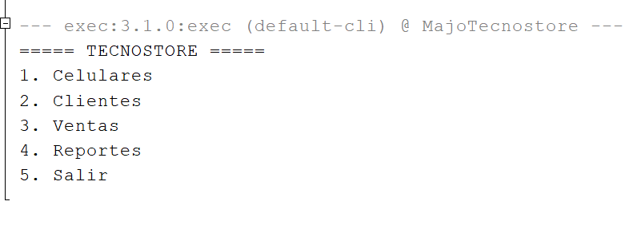
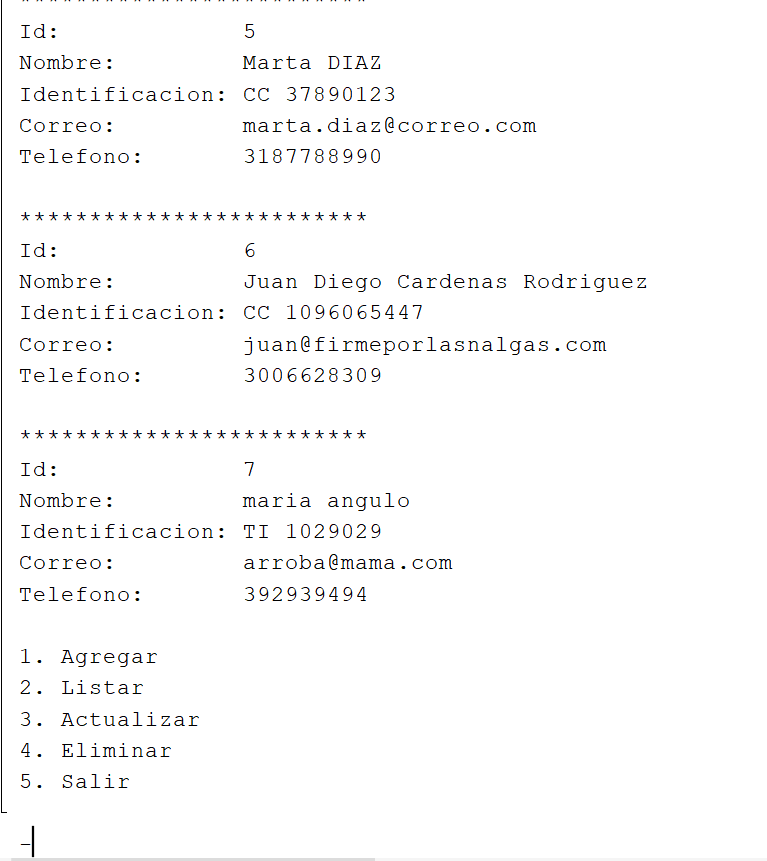
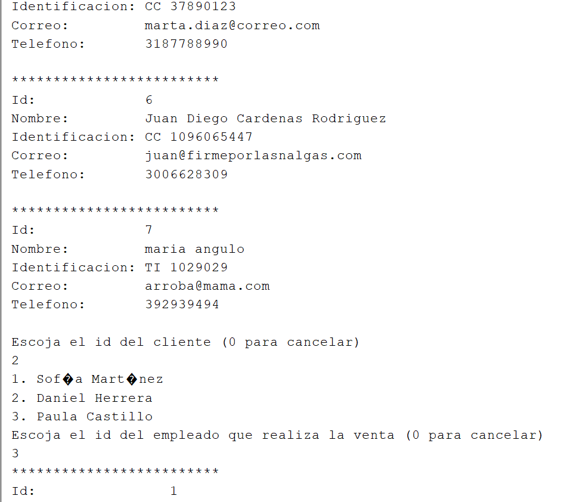

# 1. Descripción del proyecto 💻💸

TecnoStore permite gestionar el día a día de una tienda de celulares desde un menú de consola, está pensado para ser usado por el vendedor, el cual va registrando las ventas.

## 📌Funcionalidades

- **Celulares:** Permite registrar, listar, actualizar y eliminar el celular. Cada celular tiene marca, modelo, sistema operativo, gama Baja, Media o Alta, tres precios unitario, por mayor y especial los cuales no deben superar el precio unitario, y stock. Se valida que los precios sean mayores a 0 y que el stock no sea negativo, sin embargo el stock si puede ser 0.
- **Clientes:** Permite registrar, listar, actualizar y eliminar los clientes. Se valida el formato del correo "ejemplo@correo.com", valida tipos de documento comon CC, TI, CE, PA, al tener varias opciones de identificación permite el ingreso de letras y numero pero una cantidad limitada. Así mismo, valida la identificación y el correo no estén repetidos entre clientes.
- **Ventas:** Se escoge un cliente, un empleado que realiza la venta y uno o varios celulares con su tipo de precio. El total incluye **IVA del 19%**, la venta se guarda en la base de datos y el stock se descuenta automáticamente. Si algo falla, no se guarda ningún cambio.
- **Reportes** (calculados con Stream API):
  - Celulares con stock bajo (menos de 5 unidades).
  - Top 3 de celulares más vendidos.
  - Ventas totales por mes.
  - Archivo `reporte_ventas.txt` con el resumen de todas las ventas.

## 🛠️Patrones y principios aplicados

| Concepto | Dónde |
|---|---|
| Singleton | `ConexionDB` |
| Strategy | `EstrategiaPrecio` con `PrecioUnitario`, `PrecioMayor` y `PrecioEspecial` |
| Herencia | `Cliente` hereda de `Persona` |
| Composición | `Venta` contiene `ItemVenta`, y `ItemVenta` contiene un `Celular` |
| Encapsulamiento | Atributos privados con getters y setters; los setters validan los datos |
| Arquitectura | Capas: `view` → `controller` → `DAO` → base de datos, con `model` compartido |

---

## 2. Estructura de clases

```text
MajoTecnostore
├── com.mycompany.majotecnostore
│   └── MajoTecnostore.java        Punto de entrada (main)
├── controller
│   ├── GestionGeneral.java        Menú principal
│   ├── GestionCelular.java        Menú y reglas de celulares
│   ├── GestionCliente.java        Menú y reglas de clientes
│   ├── GestorVenta.java           Registro y listado de ventas
│   └── GestorReporte.java         Menú de reportes
├── DAO
│   ├── ConexionDB.java            Conexión a MySQL (Singleton)
│   ├── CelularDAO.java            Consultas JDBC de celulares
│   ├── ClienteDAO.java            Consultas JDBC de clientes
│   └── VentaDAO.java              Consultas JDBC de ventas (con transacción)
├── model
│   ├── CategoriaGama.java         Enum: BAJA, MEDIA, ALTA
│   ├── Persona.java               Clase base con los datos comunes
│   ├── Cliente.java               Hereda de Persona
│   ├── Celular.java               Entidad celular
│   ├── ItemVenta.java             Línea de una venta (celular + cantidad)
│   └── Venta.java                 Venta con sus ítems, subtotal, IVA y total
├── patron
│   ├── EstrategiaPrecio.java      Interfaz del patrón Strategy
│   ├── PrecioUnitario.java
│   ├── PrecioMayor.java
│   └── PrecioEspecial.java
├── util
│   ├── Validador.java             Validaciones de lo que se escribe en consola
│   ├── ReporteUtils.java          Cálculos de reportes con Stream API
│   └── ArchivoUtils.java          Genera reporte_ventas.txt
└── view
    ├── Ingreso.java               Menús y captura de datos
    ├── MostrarCelular.java
    ├── MostrarCliente.java
    ├── MostrarVenta.java
    └── MostrarReporte.java
```

## 3. Base de datos

**Nombre de la base de datos:** `tecnostore_db`

### Tablas

- `tipo_documento`
- `personas`
- `clientes`
- `empleado`
- `marca`
- `sistema_operativo`
- `version_sistema_operativo`
- `gama`
- `tipo_precio`
- `celulares`
- `ventas`
- `detalle_venta`
- `tipo_accion`
- `auditoria_celular`


## 📸4. Galeria proyecto funcional







---
**María José Angulo Sánchez**
